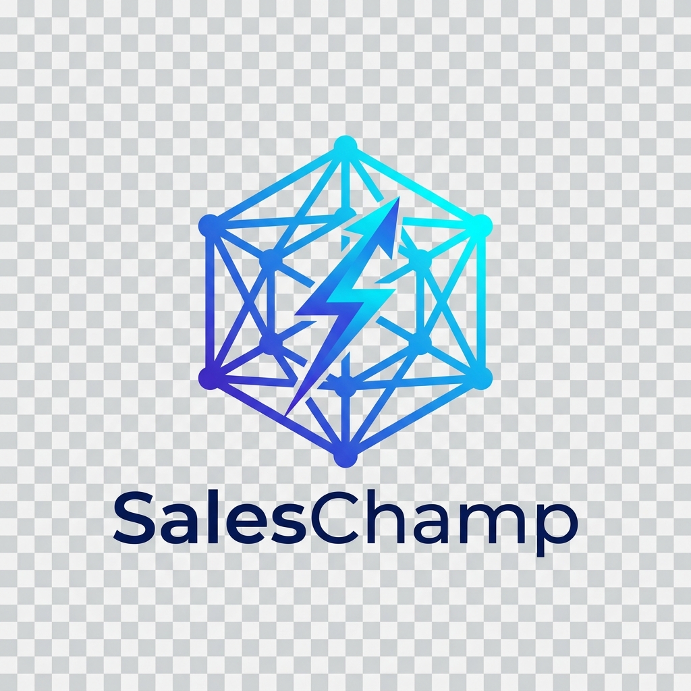

# SalesChamp: Autonomous Multi-Agent Sales Automation Platform



> **SalesChamp** is an AI-powered, multi-agent sales automation platform designed to manage the entire sales lifecycle. Instead of functioning as a simple chatbot, it acts as an autonomous Sales Development Representative (SDR) capable of reasoning and executing complex business workflows. The platform seamlessly integrates with Salesforce CRM, Microsoft Dynamics 365 Sales, and SAP S/4HANA ERP.

---

## 🌟 Key Highlights & Architecture

SalesChamp replaces brittle single-prompt chatbots with an enterprise **Multi-Agent Swarm** coordinated by an orchestrator DAG with deterministic Human-in-the-Loop (HITL) safety gates:

1. **Manager Orchestrator Agent (`agent-manager`)**: Coordinates the sequential execution DAG, handles inter-agent state passing, and enforces RevOps approval gates.
2. **Lead Discovery Agent (`agent-discovery`)**: Mines high-ICP prospects across Google Maps, LinkedIn, and corporate registries.
3. **Business Research Agent (`agent-research`)**: Analyzes 10-K filings, maps enterprise tech stacks (Salesforce, SAP, Azure), and synthesizes friction dossiers.
4. **Autonomous Proposal Agent (`agent-proposal`)**: Executes Retrieval-Augmented Generation (RAG) over indexed pricing catalogs and SLAs to generate itemized deliverables.
5. **Multi-CRM Interoperability Agent (`agent-crm`)**: Reconciles pipeline changes between Salesforce Sales Cloud and Microsoft Dynamics 365 with automated deduplication and field conflict resolution.
6. **Communication Agent (`agent-comm`)**: Drives autonomous AI voice phone calls with dynamic objection trees, real-time sentiment telemetry, and follow-up cadences.
7. **SAP ERP Fulfillment Agent (`agent-sap`)**: Interfaces with SAP S/4HANA OData/BAPI services for ATP material availability checks, credit verifications, and sales invoices.
8. **Executive Analytics Agent (`agent-analytics`)**: Synthesizes pipeline velocity telemetry and provides natural language executive query answers.

---

## 🚀 8 Core Enterprise Modules

- **Module 1: Executive Sales Analytics Dashboard (`/dashboard`)**: Real-time pipeline velocity, 8-stage conversion funnel, multi-agent execution feeds, and natural language query engine (⌘J).
- **Module 2: Multi-Agent Workflow Orchestrator Studio (`/workflow-studio`)**: Interactive 7-stage DAG canvas, model parameter inspector, and live pod telemetry.
- **Module 3: Lead Discovery & Intelligence Dossier Hub (`/lead-dossier-hub`)**: Target account roster with circular match gauges, tech stack topology, and operational friction cards.
- **Module 4: Autonomous Proposal Studio & HITL Review (`/proposal-studio`)**: Indexed RAG grounding citations, personalization directive sliders, SKU canvas, and side-by-side RevOps diff-checker.
- **Module 5: AI Voice Agent Console & Omnichannel Center (`/voice-outreach`)**: Active phone session banner, dynamic objection-handling tree, hardware-accelerated dual audio waveforms, full-duplex live transcripts, and 1-click CRM follow-up cadences.
- **Module 6: Dual CRM Interoperability & Deduplication Hub (`/crm-interoperability`)**: Tri-pane canvas (Salesforce Sales Cloud, Schema Bridge, Microsoft Dynamics 365) with 1-click delta resolution.
- **Module 7: SAP ERP Operations & Order Fulfillment Desk (`/sap-erp-operations`)**: 6-stage Order-to-Cash stepper, Business Partner master data, ATP stock verification, and BAPI sales order commit.
- **Module 8: Enterprise Admin Console & Governance (`/admin-governance`)**: Connected gateway status matrix, live latency roundtrip pings, and immutable audit logs.

---

## 🛠 Tech Stack

- **Frontend**: Next.js 16 (App Router), React 19, Vanilla CSS Design System + Tailwind CSS, Material Symbols Icons, JetBrains Mono & Plus Jakarta Sans typography.
- **Backend**: Python 3.12+, Django 5.2, Django REST Framework, Django Channels (WebSockets), SQLite/PostgreSQL.
- **Integrations**: Salesforce REST API, Microsoft Dynamics 365 Web API, SAP S/4HANA OData / BAPI, Twilio Voice SIP, ElevenLabs, OpenAI GPT-4o, Google Gemini.

---

## ⚡ Quick Start Guide

### Prerequisites
- Node.js 18+ & npm
- Python 3.10+ & pip
- Git

### 1. Clone Repository
```bash
git clone https://github.com/legendSirUmer/SalesChamp.git
cd SalesChamp
```

### 2. Backend Setup (Django REST Framework)
```bash
cd backend

# Create and activate virtual environment
python -m venv venv
# Windows:
.\venv\Scripts\activate
# macOS/Linux:
source venv/bin/activate

# Install dependencies
pip install django djangorestframework django-cors-headers channels daphne

# Run migrations and seed sample enterprise database
python manage.py migrate
python manage.py seed_saleschamp

# Run backend development server
python manage.py runserver 127.0.0.1:8000
```
Backend will be available at: `http://127.0.0.1:8000/api/`

### 3. Frontend Setup (Next.js)
```bash
cd ../frontend

# Install dependencies
npm install

# Start development server
npm run dev
```
Frontend will be available at: `http://localhost:3000`

---

## 🏛 Design & Engineering Principles

- **SOLID Principles**: Domain-driven encapsulation across Django apps (`leads`, `proposals`, `crm`, `erp`, `agents`, `governance`).
- **DRY Architecture**: Reusable UI components, centralized API service layers, and unified state management.
- **Enterprise Accessibility**: Proper form field identifiers (`id`, `name`), paired `<label htmlFor>`, and ARIA attributes across all inputs.
- **Zero-Deprecation Animations**: Hardware-accelerated CSS animations replacing legacy main-thread SVG animations.

---

## 📄 License

This project is licensed under the Apache 2.0 License - see the [LICENSE](LICENSE) file for details.
